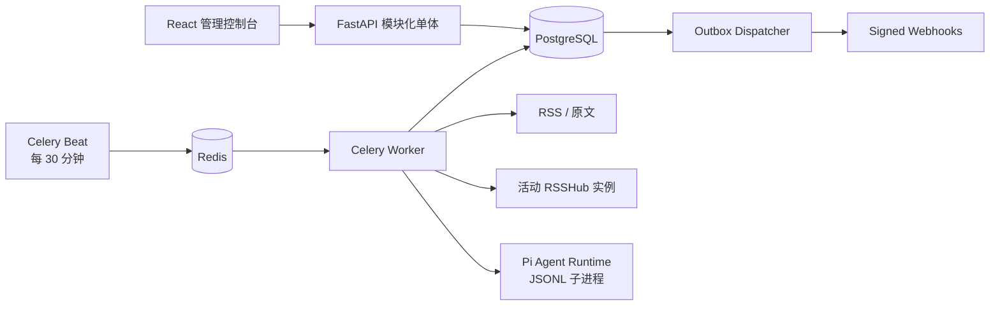

# ZeroMind

ZeroMind 是一个以“引用优先”为原则的 RSS 信息收集与 Agent 分析平台。系统保存 RSS
订阅、原文引用、元数据修订和结构化分析结果，但不会保存抓取到的文章正文或网页快照。

## 能力

- 单条添加或通过 OPML 1.0/2.0 批量导入 RSS。
- 以 `rsshub://` 保存实例无关的 RSSHub 路由，支持多实例注册、活动实例选择和加密
  Access Key。
- 每 30 分钟认领到期 Feed，并使用 10 分钟时间重叠、HTTP 条件请求和稳定条目标识保证幂等。
- 安全地即时解析原文：限制协议、大小、重定向，并阻止内网/本地地址。
- 注册 Provider Profile 和多个带不可变版本的 Agent；密钥只保存环境变量名，执行内核使用 Pi。
- 使用受限 YAML DSL 编排 DAG，支持元数据初筛、确定性门禁、运行期原文解析、细筛和
  六维加权评分。
- 将分类、摘要、观点、金句、评分和执行溯源投影成幂等的结构化分析；信息流默认只展示
  有效结论为“通过”的内容。
- 支持带审计记录的人工改判，以及共享阅读笔记创建、编辑和删除。
- 通过事务型 outbox 恢复任务，通过 HMAC-SHA256 webhook 投递结果。
- 提供无需登录的 React 管理控制台。

## 快速启动

需要 Docker Engine 24+ 与 Compose v2。

```bash
cp .env.example .env
# 编辑 .env，替换数据库密码和凭证加密密钥
docker compose up --build -d
docker compose ps
```

浏览器打开 `http://localhost:8080`，直接进入管理控制台，无需登录。

首次配置顺序：

1. Compose 已内置仅容器网络可访问的 RSSHub。在“RSSHub”中注册实例：名称填
   `Built-in RSSHub`，Base URL 填 `http://rsshub:1200`，Access Key 留空，鉴权模式选
   `key` 并保持启用；第一个启用的实例会自动成为活动实例。
2. 在“订阅源”中添加 HTTP(S) Feed、`rsshub://twitter/user/vista8`，或者预览并导入
   OPML。
3. 在“智能体”中创建 Provider Profile；`api_key_env` 填环境变量名，例如
   `OPENAI_API_KEY`。把 API 返回的 Provider ID 记下来。
4. 若 Provider 配置名为 `GLM`，运行下面的幂等注册命令。它会注册六个分析 Agent、替换 DSL
   中的 Agent ID，并保存及激活 `信息分析工作流`：

   ```bash
   docker compose run --rm api \
     python scripts/register_analysis_agents.py --provider-name GLM
   ```

   也可以用 `--provider-id <UUID>` 精确指定 Provider。
5. 在“智能体”确认六个 Agent 均已启用；“查看版本”可以检查 system prompt、能力和 Schema
   历史。在“工作流”确认完整分析工作流已激活。
6. 可选：注册 webhook，`secret_env` 同样填写环境变量名。

六份 [Agent JSON 示例](apps/information/docs/examples) 中的 `provider_profile_id` 和
[完整分析工作流](apps/information/docs/examples/article-analysis.yaml) 中的六个 `agent_id` 都是占位 UUID；注册
脚本会使用数据库中的真实 ID。Provider 密钥必须注入 API/worker 容器环境，JSON、Agent 版本
和 session 中都不会保存密钥。

## 使用结构化信息流

- “信息流”默认显示有效决定为“通过”的分析；切换“已拒绝”可审计初筛拒绝、细筛拒绝和
  被人工拒绝的内容。
- 可按最低分、分类、订阅源和日期区间筛选。卡片只包含 RSS 元数据和结构化分析，不包含
  抓取的文章正文。
- 详情页展示摘要、观点、最多 5 条且每条最多 300 字符的金句、确定性加权评分、推荐理由、
  工作流版本、Agent、Provider 和模型溯源。
- 人工改判会追加不可覆盖的审计记录，不会修改 Agent 生成状态、分数或原始分析。
- 阅读笔记共享访问，可关联当前分析或只关联原文引用；支持创建、编辑和删除。
  历史笔记归属和分析修订者信息保留，新记录统一标记为 `local`。

元数据初筛不会解析原文。只有通过初筛门禁的内容才会在单次工作流运行期间解析正文，并按
核心分析、分类、评分、审核、最终优化的顺序调用其余五个 Agent。每次调用或重试都会生成一条
可关联工作流、步骤和不可变 Agent 版本的 session；正文会先替换为哈希和字符数再持久化。

## 架构



后端按 DDD bounded context 划分：

- `subscriptions`：订阅聚合与 OPML。
- `rsshub`：实例注册、Access Key 加密和逻辑路由解析。
- `ingestion`：Feed 条目标识、引用和元数据修订。
- `content`：无持久化的安全原文解析。
- `agents`：Provider、Agent Registry 与 Pi Gateway。
- `workflows`：安全 DSL、确定性评分与门禁、定义、运行和步骤时间线。
- `analysis`：结构化分析投影、信息流查询、游标和人工决定审计。
- `notes`：共享的引用/分析笔记及关联校验。
- `delivery`：webhook 终点与签名投递。
- `shared`：公共配置、数据库和 outbox。

订阅模块的上下文边界、聚合根、值对象、领域方法和包结构见
[订阅管理领域设计](apps/information/docs/domains/subscriptions.md)。

## 本地开发与验证

```bash
python3 -m venv .venv
.venv/bin/pip install -e 'apps/information[dev]'
cd apps/information
../../.venv/bin/pytest -q
../../.venv/bin/ruff check src tests
../../.venv/bin/mypy src

cd ../agent-runtime
pnpm install
pnpm test
pnpm typecheck
pnpm build

cd ../web
pnpm install
pnpm test
pnpm typecheck
pnpm build
```

API 文档位于 `/api/docs`。当前未启用身份认证，管理接口和健康检查均无需令牌。

更详细的升级、备份、恢复和故障处理见
[运维手册](apps/information/docs/operations.md)。

历史内容可通过 `scripts/backfill_reference_analysis.py` 分阶段加入“信息分析工作流”；先使用
`--all --dry-run` 检查数量，再按运维手册执行小批量和全量 generation。
