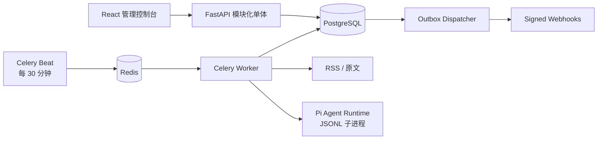

# ZeroMind

ZeroMind 是一个以“引用优先”为原则的 RSS 信息收集与 Agent 分析平台。系统保存 RSS
订阅、原文引用、元数据修订和结构化分析结果，但不会保存抓取到的文章正文或网页快照。

## 能力

- 单条添加或通过 OPML 1.0/2.0 批量导入 RSS。
- 每 30 分钟认领到期 Feed，并使用 10 分钟时间重叠、HTTP 条件请求和稳定条目标识保证幂等。
- 安全地即时解析原文：限制协议、大小、重定向，并阻止内网/本地地址。
- 注册 Provider Profile 和多个 Agent；密钥只保存环境变量名，执行内核使用 Pi。
- 使用受限 YAML DSL 编排 DAG，支持依赖、并行层、超时、有限重试和结构化结果。
- 通过事务型 outbox 恢复任务，通过 HMAC-SHA256 webhook 投递结果。
- 提供带管理员令牌的 React 管理控制台。

## 快速启动

需要 Docker Engine 24+ 与 Compose v2。

```bash
cp .env.example .env
# 编辑 .env，替换数据库、管理员和令牌密钥
docker compose up --build -d
docker compose ps
```

浏览器打开 `http://localhost:8080`，使用 `.env` 中的管理员账号登录。

首次配置顺序：

1. 在“订阅源”中添加 Feed 或预览并导入 OPML。
2. 创建 Provider Profile；`api_key_env` 填写环境变量名，例如 `OPENAI_API_KEY`。
3. 创建 Agent，配置 system prompt、capabilities 以及 JSON Schema 输入输出契约。
4. 复制 [示例工作流](docs/examples/article-analysis.yaml)，替换 `agent_id`，校验并激活。
5. 可选：注册 webhook，`secret_env` 同样填写环境变量名。

## 架构



后端按 DDD bounded context 划分：

- `subscriptions`：订阅聚合与 OPML。
- `ingestion`：Feed 条目标识、引用和元数据修订。
- `content`：无持久化的安全原文解析。
- `agents`：Provider、Agent Registry 与 Pi Gateway。
- `workflows`：DSL、定义、运行和步骤时间线。
- `delivery`：webhook 终点与签名投递。
- `identity` / `shared`：管理员鉴权、数据库和 outbox。

## 本地开发与验证

```bash
python3 -m venv .venv
.venv/bin/pip install -e 'backend[dev]'
cd backend
../.venv/bin/pytest -q
../.venv/bin/ruff check src tests
../.venv/bin/mypy src

cd ../pi-runner
pnpm install
pnpm test
pnpm typecheck
pnpm build

cd ../frontend
pnpm install
pnpm test
pnpm typecheck
pnpm build
```

API 文档位于 `/api/docs`。生产应用默认保护 `/api/v1/*`（除登录接口），健康检查不需要令牌。

更详细的升级、备份、恢复和故障处理见 [运维手册](docs/operations.md)。

