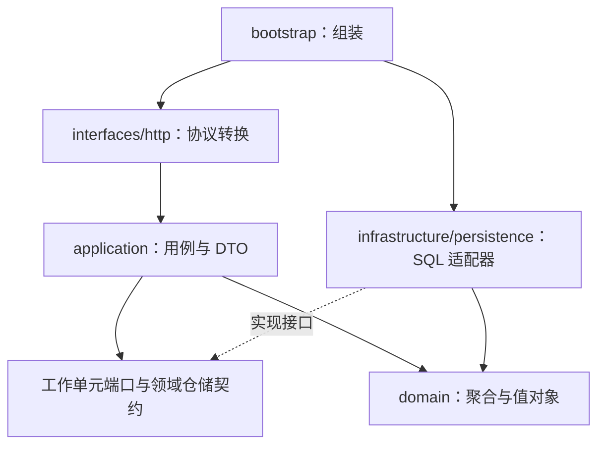

# 应用分层与事务

状态：来源管理链路已实现；其余能力参见 [状态表](../README.md)。

箭头表达代码依赖/组装，而非网络请求。领域不依赖 FastAPI 或 SQLAlchemy。

| 层 | 入口 | 职责 |
| --- | --- | --- |
| 启动 | [app.py](../../src/subscription_service/bootstrap/app.py) | 读取专属配置、组装依赖、注册错误处理、关闭自有连接池 |
| HTTP | [routes.py](../../src/subscription_service/interfaces/http/routes.py) | 请求模型转用例参数，DTO 转响应 |
| 应用 | [subscription_service.py](../../src/subscription_service/application/subscription_service.py) | 创建/查询/修改/启停、配置版本检查、事务提交 |
| 领域 | [subscription.py](../../src/subscription_service/domain/aggregates/subscription.py) | 业务校验及状态转换 |
| 持久化 | [unit_of_work.py](../../src/subscription_service/infrastructure/persistence/unit_of_work.py) | 两仓储共享会话，显式提交、退出清理 |

应用端口只声明来源管理所需能力；具体工作单元还提供 items 仓储。后续条目应用服务应显式扩展自身所需端口。
返回 SubscriptionView 不暴露 ORM 对象；DTO 为冻结数据类，避免会话退出后的懒加载依赖。

## 事务规则

每次单条管理用例创建新工作单元；OPML 导入则每个候选来源独立工作单元。add/save 会 flush 以验证约束，但不提交；成功显式 commit 后才记录写入成功。
查询不提交写入，退出释放事务与会话。失败回滚，不能复用已失败事务继续操作。
仓储仅允许保存本工作单元加载或添加的同一个实例；只改领域对象而不 save 不会持久化。
configuration_version 面向客户端，row_version 面向 ORM 读写竞争，两者互不替代。
映射和错误转换见 [持久化](persistence.md)，各业务流见 [时序索引](sequences/README.md)。

## 装配与运行限制

应用工厂不自动迁移，不读取根 .env。默认独立 SQLite；可显式配置 PostgreSQL。
工厂创建的连接池由应用退出时释放；测试注入的连接池由调用者释放。
尚无消息总线、Outbox、鉴权、任务调度或网络抓取依赖。

## OPML 扩展

[OpmlImportService](../../src/subscription_service/application/opml_import_service.py) 依赖工作单元和 [OpmlReader 端口](../../src/subscription_service/application/ports/opml_reader.py)，不依赖具体 XML 库。
[SafeOpmlReader](../../src/subscription_service/infrastructure/opml/reader.py) 使用 defusedxml 安全解析；启动工厂将二者组装。
[独立 HTTP 路由](../../src/subscription_service/interfaces/http/opml_routes.py) 流式收集限额内原始 XML，转换导入结果和文件级错误。
不调用单条创建 HTTP，也不改变单条创建的重复地址 409 行为。逐项事务及中断处理见 [时序图](sequences/opml-import.md)。
