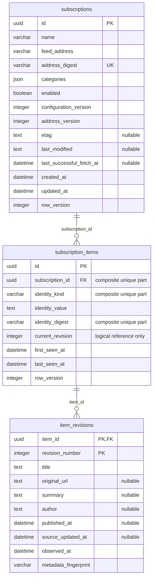

# 物理 ER 图

依据 [ORM 模型](../../src/subscription_service/infrastructure/persistence/models.py) 和 [初始迁移](../../migrations/versions/0001_subscription_domain.py)。
当前三张业务表；Alembic 的 alembic_version 是迁移元数据表，不是领域实体。

## 关系与约束说明

- 每个条目恰好属于一个来源；来源可没有条目。两个外键均为 ON DELETE RESTRICT。
- 图按数据库可强制的基数画为条目对应零到多修订；领域和仓储要求每个新条目同时保存至少一个修订。
- item_revisions 主键为 (item_id, revision_number)，不是两个独立唯一字段。
- 条目复合唯一索引为 (subscription_id, identity_kind, identity_digest)，各组成字段不单独唯一。
- current_revision 与 (item_id, revision_number) 的匹配由领域和仓储保证，数据库没有反向复合外键。
- 来源地址通过 SHA-256 摘要唯一索引查重；条目身份摘要同理。查询仍核对原值；理论哈希碰撞可能导致冲突，不覆盖记录。
- 数据库约束版本号为正、identity_kind 属于 guid/url/hash；修订连续性和历史不可变主要由应用路径保证。
- 图中未写 nullable 的业务列均非空。数据库管理员直接 SQL 不受全部领域规则保护。

字段用途、索引目的及迁移方式见 [持久化](persistence.md)。FetchCheckpoint 和 ItemMetadata 平铺在表列中，不独立建表。
