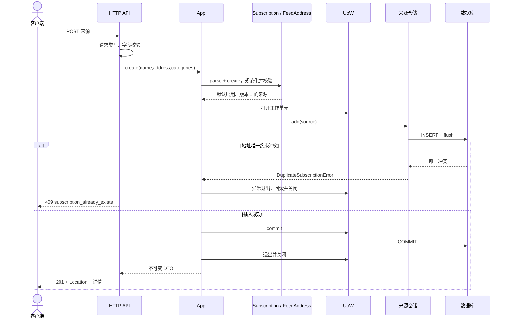

# SUB-001 创建来源

状态：已实现。对应 [应用服务](../../../src/subscription_service/application/subscription_service.py) 的 create。

请求校验失败在进入应用服务前返回 422；领域校验失败发生在打开工作单元前，同样无写入。
其他数据库异常不会伪装成地址重复；提交失败也不能返回创建成功。
没有“先查再插”作为唯一保障，数据库唯一约束处理竞争写入。
