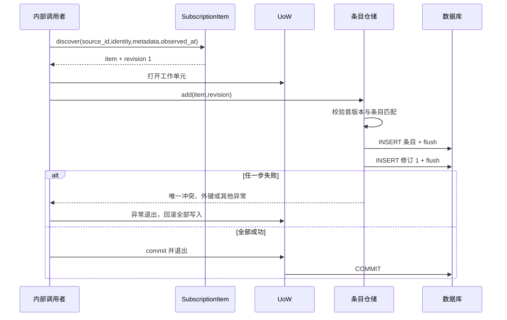
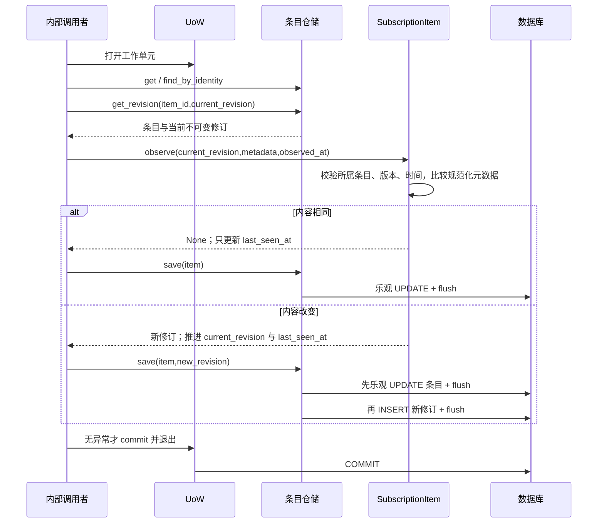
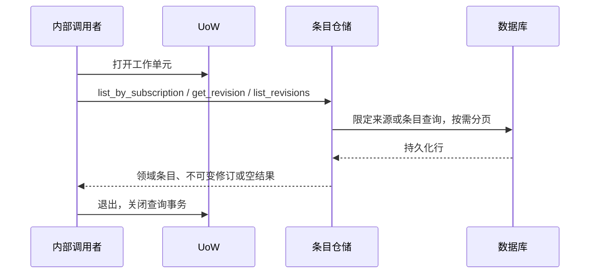

# SUB-006 / SUB-007 条目与修订

状态：以下领域方法和仓储操作已实现；图中的“调用者”是内部调用示例或测试，不是已存在的采集应用服务。

## 首次发现

同来源身份重复是 DuplicateItemError，缺失来源的外键错误不会被当作重复处理。

## 再次观察

观察校验失败不改变聚合；保存期间任一步失败则退出回滚，不执行图末的 commit。
版本推进必须伴随新修订，新修订必须连续，历史版本不可覆盖。无变化也必须 save 才能保存观察时间。

## 查询条目与历史

尚无对应 HTTP 入口；不把仓储 None 自动解释成公开 API 的 404。
