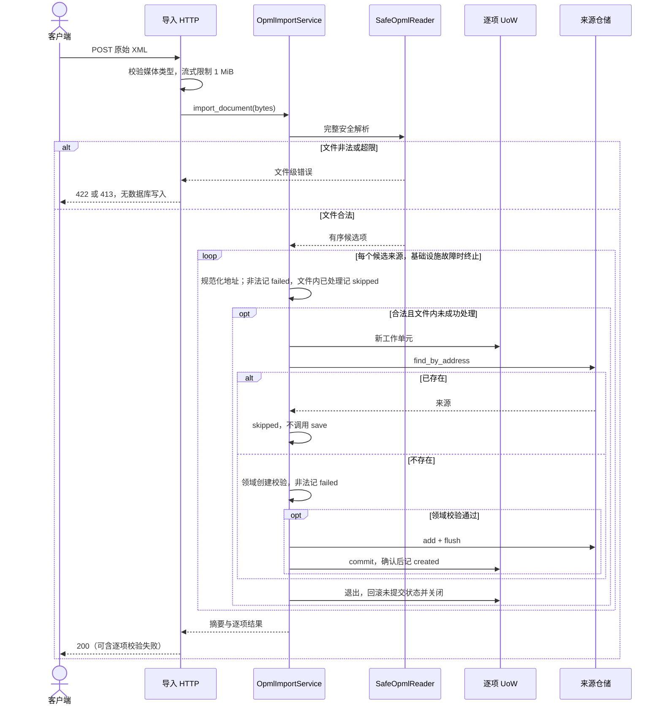

# SUB-005 OPML 导入时序

状态：已实现。导入只创建来源，不访问外部 Feed 或文章表。

## 异常分支

查重后发生唯一冲突：退出当前工作单元回滚，记 already_exists/skipped，继续下一条；不复用失败会话。
其他存储或非业务异常：当前工作单元退出，应用服务停止循环，HTTP 返回 503 而非上图的 200。
503 的 detail.result 包含此前确认提交项、当前未确认成功项及 remaining。此前提交不回滚，重传按地址跳过。
非法候选不进入文件内成功去重集合，因此后续相同地址的合法项可以创建。
已有来源跳过先于新名称/分类校验，保证导入不会修改或重新启用它。
