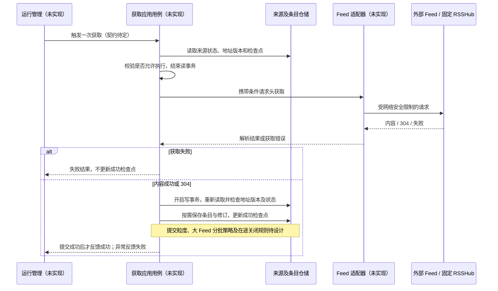

# 规划中的流程

以下是设计草图，不能用于声称功能可调用或已被集成测试覆盖。

OPML 已实现，见 [实际导入时序](opml-import.md)，不再列为规划流程。

## SUB-008 来源获取与运行管理协作

方向约定：运行管理负责调度、超时、重试和执行记录；订阅侧负责来源有效性和数据规则。
网络调用不应持有长数据库事务。地址变化后的旧结果必须拒绝，不能仅比较地址字符串；接收条目前和更新检查点时均需防护。
304 不新增修订，但仍可记录本次成功并保留已有请求校验头。
Feed 地址格式校验不代替 SSRF、重定向和响应限额策略。RSSHub 由用户部署和配置凭据，服务不管理其容器。
事件可靠发布、消息队列、重试幂等契约、并发获取策略均未实现，需要后续独立设计。
