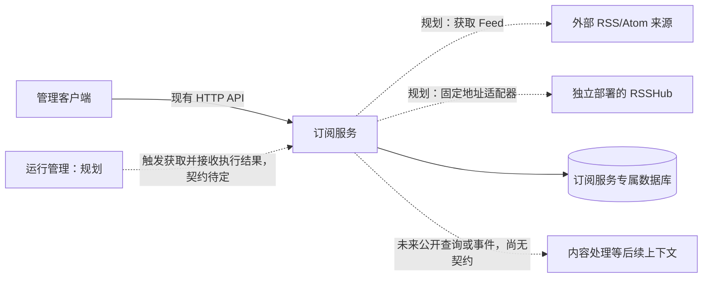

# 项目上下文地图

状态：订阅服务已部分实现，其余上下文仅用于说明目标边界，不代表已部署。

实线表示已有实现关系；虚线表示规划关系。RSSHub 是外部 Feed 提供设施，不是订阅领域内的实例管理子模块。

| 参与方 | 拥有的职责与数据 | 不承担 |
| --- | --- | --- |
| 订阅服务 | 来源配置、条目身份、元数据修订、成功获取检查点 | 调度计划、重试队列、执行日志 |
| 运行管理（规划） | 触发时间、超时、重试、任务生命周期和执行结果 | 订阅来源和条目表的直接读写 |
| RSSHub（外部） | 将特定网站转换为 Feed；容器内配置凭据 | 订阅业务管理 |
| 后续内容服务（未设计） | 将来独立定义的正文、AI 或阅读能力 | 导入订阅内部领域代码 |

服务之间只通过明确接口或事件协作，不跨库关联，不共享 ORM 模型。
订阅服务处理一次获取的业务规则和条目持久化；运行管理负责何时运行、如何重试，不把两者混成一个任务聚合。
此处是职责分配，不承诺尚未实现的网络执行位置、消息系统或重试契约。

详见 [订阅上下文](../../apps/subscriptions/docs/domain/context.md) 和 [规划时序](../../apps/subscriptions/docs/implementation/sequences/planned-flows.md)。
